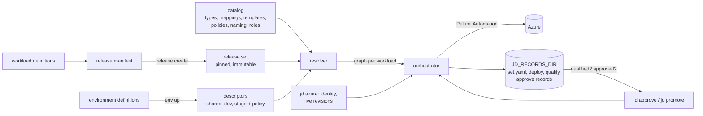
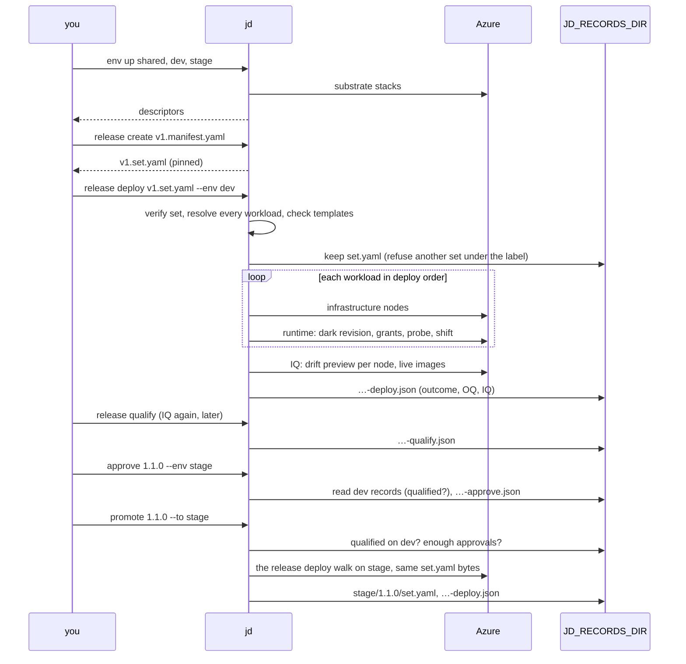

# Walkthrough: testing `jd` by hand

From an empty subscription to a release promoted to `stage`, through every check the tool makes, then teardown. Read top to bottom; the
scenarios build on each other. Command syntax and exit codes: [usage.md](usage.md). The files used here: [samples/walkthrough](../samples/walkthrough/README.md).
Every expected output below comes from the code and from the Azure test that runs the same steps (`src/jd.cli.tests/EnvUpAzureTests.cs`);
where a step is not covered by a test, it says so.

## 1. Architecture

| Part | What it is | Depth |
|---|---|---|
| Workload definition | What a team declares: image (pinned by digest), variables, ports, `requires` by type (`database`). No Azure detail. | [workload-definition.md](architecture/workload-definition.md) |
| Catalog (`catalog/`) | The platform's knowledge as data: **types** (the contract), **mappings** (requirement → graph nodes), **templates** (Pulumi YAML), **policies** (IT Ops rules: add, set, forbid), **naming**, **roles**. | [resolver.md](architecture/resolver.md), [provisioning.md](architecture/provisioning.md) |
| Environment definition → descriptor | `jd env up` provisions an environment's substrate (`shared` once, then `dev`, `stage`) and writes its **descriptor**: the real ids workloads resolve against, and for `stage` the **approval policy**. | [resolver.md](architecture/resolver.md#environment-descriptor), [approvals.md](architecture/approvals.md) |
| Resolver → graph | Workload + catalog + descriptor → a graph of nodes (template, config with provenance, dependencies, phase). Pure, offline: `jd preview` prints it. | [resolver.md](architecture/resolver.md) |
| Orchestrator + Pulumi Automation | Deploys the graph node by node, one Pulumi stack each, in order; the runtime node last as a release: dark revision, grants, probe, traffic shift. | [provisioning.md](architecture/provisioning.md#orchestrator) |
| `jd.azure` | The Azure adapter: who the principal is (claims of an ARM token) and the live revisions of a Container App (for IQ). | [release-record.md](architecture/release-record.md#3-machine-identity) |
| Release manifest → set | A label plus workloads in dependency order; `jd release create` pins every definition (SHA-256) and image (digest) into an immutable set. | [release.md](architecture/release.md) |
| Release records | One JSON file per deploy, qualify and approval under `JD_RECORDS_DIR`, never edited: outcome, identity, OQ, IQ, timings. | [release-record.md](architecture/release-record.md) |
| Approvals, promotion | `jd approve` records that a listed principal approves a qualified set; `jd promote` deploys the set kept on `dev` to `stage` when enough approvals count. | [approvals.md](architecture/approvals.md) |



## 2. The flow



| Step | Checks / refuses |
|---|---|
| `env up` | Resolves the definition and composes the descriptor before creating anything; `--out` must not exist without `--force`. |
| `preview` | Validates, resolves, prints every node with provenance. Creates nothing; needs no credentials. |
| `deploy` | One workload, **no record**. Refused on a gated environment. |
| `release deploy` | Re-verifies the set, resolves every workload and checks templates before the first node; refuses a different set under a kept label; first failure stops the run; IQ after success. Refused on a gated environment. |
| `release qualify` | IQ only: no node drifted, every revision with traffic runs the pinned image. Deploys nothing. |
| `approve` | Label known and qualified on `qualifiedOn`, principal listed, separate from the deployers if required, not a repeat. |
| `promote` | Qualified on `qualifiedOn` and `required` distinct approvals count, judged from the records now; then the `release deploy` walk with the kept bytes. |

Records layout (after this walkthrough):

```
$JD_RECORDS_DIR/
  dev/1.1.0/      set.yaml  <time>-deploy.json
  dev/1.2.0/      set.yaml  <time>-deploy.json (one per attempt)  <time>-qualify.json (one per qualify)
  dev/1.3.0-bad/  set.yaml  <time>-deploy.json (outcome failed)
  stage/1.1.0/    set.yaml (dev's bytes)  <time>-approve.json  <time>-deploy.json
```

`<time>` is UTC `yyyyMMddTHHmmssfffZ`. "Qualified" on `dev` means: the newest deploy record of the label succeeded, each workload's OQ in it
`passed` (or `unchanged` with an earlier deploy of the **same label** that passed it), and the newest record's IQ `passed`.

## 3. Setup

Prerequisites: .NET SDK, `pulumi` CLI, `az` CLI, `jq`; a subscription with the guardrails of [tools/sandbox](../tools/sandbox/README.md) and **no
free-tier Cosmos account** yet; a deploying service principal. Run everything from the repository root.

```bash
cp samples/walkthrough/env.example.sh ~/jd-walkthrough.env.sh      # outside the repo; fill in the placeholders
source ~/jd-walkthrough.env.sh                                     # also builds jd once into $JD_WALK/jd
mkdir -p "$JD_WALK" "$JD_RECORDS_DIR" "${PULUMI_BACKEND_URL#file://}"
az login --service-principal --username "$ARM_CLIENT_ID" --password="$ARM_CLIENT_SECRET" --tenant "$ARM_TENANT_ID" --output none
az account set --subscription "$ARM_SUBSCRIPTION_ID"
```

Environments (exit 0 each; one node line per substrate node, then the descriptor path):

```bash
jd env up samples/environments/shared.yaml --catalog catalog --out "$JD_WALK/shared.env.yaml"
jd env up samples/environments/dev.yaml    --catalog catalog --base "$JD_WALK/shared.env.yaml" --out "$JD_WALK/dev.env.yaml"
jd env up samples/environments/stage.yaml  --catalog catalog --base "$JD_WALK/shared.env.yaml" --out "$JD_WALK/stage.env.yaml"
DEV_RG=$(sed -n 's/^  resourceGroup: *//p' "$JD_WALK/dev.env.yaml")
STAGE_RG=$(sed -n 's/^  resourceGroup: *//p' "$JD_WALK/stage.env.yaml")
```

Look at: the Cosmos account is free tier, capped at 1,000 RU/s, refuses keys; `db-dev` and `db-stage` hold 400 RU/s each.

```bash
az cosmosdb list --query "[].{name:name, free:enableFreeTier, limit:capacity.totalThroughputLimit, noKeys:disableLocalAuth}" -o table
COSMOS=$(az cosmosdb list --query "[0].name" -o tsv)
COSMOS_RG=$(az cosmosdb list --query "[0].resourceGroup" -o tsv)
for db in db-dev db-stage; do
  az cosmosdb sql database throughput show -a "$COSMOS" -g "$COSMOS_RG" -n "$db" --query "resource.throughput" -o tsv     # 400 each
done
```

Re-running an `env up` (with `--force`) reports every node `unchanged (no changes, …)` and rewrites the same descriptor. `stage` ships with the all-zero
approver; the scenarios make policy variants with `samples/walkthrough/stage-policy.sh` instead of editing it.

Release sets are created **once** and reused: a set carries its creation time, so creating it again gives other bytes, which a label that already has a
`set.yaml` refuses.

```bash
for r in v1 v2 bad; do jd release create samples/walkthrough/releases/$r.manifest.yaml --out "$JD_WALK/$r.set.yaml"; done
```

Expected: `…/v1.set.yaml: release 1.1.0 with 2 workload(s), deploy order just-deliver-sample-app, just-deliver-sample-worker.` (and `1.2.0`, `1.3.0-bad`).

Helpers used below (offline: the names come from `jd preview`):

```bash
APP=$(jd preview samples/walkthrough/workloads/app.yaml --env "$JD_WALK/dev.env.yaml" --catalog catalog | sed -n 's/^  containerAppName = \([^ ]*\).*/\1/p')
WORKER=$(jd preview samples/walkthrough/workloads/worker.v1.yaml --env "$JD_WALK/dev.env.yaml" --catalog catalog | sed -n 's/^  containerAppName = \([^ ]*\).*/\1/p')
revisions() { az containerapp revision list --all -g "$DEV_RG" -n "$1" --query "[].{revision:name, weight:properties.trafficWeight, image:properties.template.containers[0].image}" -o table; }
newest() { ls "$JD_RECORDS_DIR/$1/$2/"*-"$3".json | tail -1; }       # newest <env> <label> <deploy|qualify|approve> record
summary() { jq '{activity, outcome, iq: .iq.status, notStarted, workloads: [.workloads[] | {name, oq: .oq.status, nodes: [.run.nodes[]? | .outcome]}]}' "$1"; }
```

## 4. Scenarios

### 1. First deploy of `sample-app`; re-run changes nothing

Purpose: the unrecorded single-workload path; idempotency.

```bash
jd preview samples/workloads/sample-app.yaml --env "$JD_WALK/dev.env.yaml" --catalog catalog
jd deploy  samples/workloads/sample-app.yaml --env "$JD_WALK/dev.env.yaml" --catalog catalog
jd deploy  samples/workloads/sample-app.yaml --env "$JD_WALK/dev.env.yaml" --catalog catalog
```

Expected: `preview` lists five nodes (`@workload/appinsights`, `database/container`, `@workload/runtime`, and the grants `database/access`,
`@workload/appinsights-access`) with provenance, e.g. `APPLICATIONINSIGHTS_CONNECTION_STRING … [PolicySet: enforce-monitoring …]`. The first `deploy`
exits 0 with `…: deployed (create 1, …)` per node; the runtime last with `dark: done (<revision>)`, `grants: done`, `probe: done (HTTP 200)`,
`shift: done (<revision>)`. The re-run exits 0 with every node `unchanged (no changes, …)` and the runtime's probe and shift `skipped`. No record is written.

Look at: one revision at 100 %; the app writes and reads its container with its own identity (the first calls after scale-to-zero may answer 503; retry):

```bash
revisions "$APP"
FQDN=$(az containerapp show -g "$DEV_RG" -n "$APP" --query properties.configuration.ingress.fqdn -o tsv)
curl -s "https://$FQDN/health"                                                     # {"status":"healthy"}
curl -si -X POST "https://$FQDN/items" -H 'content-type: application/json' -d '{"text":"hello"}'   # 201, Location: /items/<id>
```

Reset: none needed (scenario 2 changes the app's config, so it is deployed again).

### 2. Two-workload release v1

Purpose: order, records, OQ and IQ. `v1` (label `1.1.0`): the app (`APP_VERSION: "1"`) and the worker, which depends on it.

```bash
jd release show   "$JD_WALK/v1.set.yaml"
jd release deploy "$JD_WALK/v1.set.yaml" --env "$JD_WALK/dev.env.yaml" --catalog catalog
```

Expected (exit 0): `workload just-deliver-sample-app` before `workload just-deliver-sample-worker`; each runtime `deployed` with `probe: done (HTTP 200)` and
`shift: done …`; then `release 1.1.0 on dev: 2 deployed, 0 unchanged, 0 failed, 0 not started.`, `release 1.1.0 on dev: IQ passed, <n> checks, 0 failed.`
and `record: <JD_RECORDS_DIR>/dev/1.1.0/<time>-deploy.json`. The app had a live revision (scenario 1), so its new one was dark until probed; the worker's
first revision served before its probe (a first deploy cannot be protected).

```bash
ls "$JD_RECORDS_DIR/dev/1.1.0"                       # set.yaml  <time>-deploy.json
summary "$(newest dev 1.1.0 deploy)"                 # outcome succeeded, iq passed, oq passed for both
jq '[.iq.checks[] | {workload, kind, status}]' "$(newest dev 1.1.0 deploy)"   # five drift checks per workload, an image check per serving revision; all passed
jq '{identity, deploySeconds, iqSeconds: .iq.elapsedSeconds}' "$(newest dev 1.1.0 deploy)"
```

Reset: none.

### 3. Release v2 changes only the second workload

Purpose: a new version of one workload; the other is untouched. `v2` (`1.2.0`): the same app, the worker with `APP_VERSION: "2"`.

```bash
jd release deploy "$JD_WALK/v2.set.yaml" --env "$JD_WALK/dev.env.yaml" --catalog catalog
```

Expected (exit 0): the app's five nodes `unchanged (no changes, …)`; the worker's runtime `deployed` with `dark: done (<new revision>)`, `grants: done`,
`probe: done (HTTP 200)`, `shift: done (<new revision>)`; `release 1.2.0 on dev: 1 deployed, 1 unchanged, 0 failed, 0 not started.`; IQ passed.

```bash
revisions "$WORKER"                                  # the v1 revision 0, the new one 100
summary "$(newest dev 1.2.0 deploy)"                 # app: oq unchanged, nodes all "unchanged"; worker: oq passed
```

Note: `1.2.0` is **not qualified yet**: its app's OQ is `unchanged` and no earlier deploy of `1.2.0` passed it (the pass was under `1.1.0`).
Scenario 4's revert changes that.

### 4. Bad release: failing probe

Purpose: a revision that fails its probe never gets traffic. `bad` (`1.3.0-bad`): the app's `COSMOS_CONTAINER` names a container that does not
exist, so `/health` answers 503.

```bash
jd release deploy "$JD_WALK/bad.set.yaml" --env "$JD_WALK/dev.env.yaml" --catalog catalog; echo "exit $?"
```

Expected after about five minutes (the probe retries for the mapping's `timeoutSeconds: 300`): exit 1; under `workload just-deliver-sample-app` the runtime
shows `dark: done (<bad revision>)`, `grants: done`, `probe: failed …` and **no** `shift:` line; no `workload just-deliver-sample-worker` line;
`release 1.3.0-bad on dev: 0 deployed, 0 unchanged, 1 failed, 1 not started (just-deliver-sample-worker).`; on stderr
`jd: stopped at just-deliver-sample-app, node just-deliver-sample-app/dev/@workload/runtime: …`; `record: …` (no IQ line: a failed deploy runs no IQ).

```bash
revisions "$APP"                                     # the good revision still 100, the bad one 0
summary "$(newest dev 1.3.0-bad deploy)"             # outcome failed, iq notRun, oq [failed, notRun], notStarted [just-deliver-sample-worker]
```

Revert: deploy the good set again. The app's old config is deployed as a **new** revision, probed and given all the traffic; the worker is unchanged.

```bash
jd release deploy "$JD_WALK/v2.set.yaml" --env "$JD_WALK/dev.env.yaml" --catalog catalog   # 1 deployed, 1 unchanged; IQ passed
revisions "$APP"                                     # a revision not seen before at 100
```

Also refused here (exit 1, nothing deployed): a set of other bytes under a label that already holds one. Make a copy of the bad manifest with label
`1.2.0` (its relative workload paths made absolute) and create and deploy its set:

```bash
sed -e 's/^label: .*/label: 1.2.0/' -e "s#\.\./workloads#$PWD/samples/walkthrough/workloads#" samples/walkthrough/releases/bad.manifest.yaml > "$JD_WALK/clash.manifest.yaml"
jd release create "$JD_WALK/clash.manifest.yaml" --out "$JD_WALK/clash.set.yaml"
jd release deploy "$JD_WALK/clash.set.yaml" --env "$JD_WALK/dev.env.yaml" --catalog catalog; echo "exit $?"
```

Expected: exit 1, `jd: '…/dev/1.2.0/set.yaml' holds a different release set for label 1.2.0 on dev (sha256 …, this one …); a label names one set, so use a new label.`

### 5. A policy added as a catalog file only (offline)

Purpose: IT Ops change behaviour without touching workloads or code. Nothing reaches Azure.

```bash
rm -rf "$JD_WALK/catalog" && cp -r catalog "$JD_WALK/catalog"
cp samples/walkthrough/policies/limit-revisions.yaml "$JD_WALK/catalog/policies/"
jd preview samples/walkthrough/workloads/app.yaml --env "$JD_WALK/dev.env.yaml" --catalog catalog            | grep maxInactiveRevisions
jd preview samples/walkthrough/workloads/app.yaml --env "$JD_WALK/dev.env.yaml" --catalog "$JD_WALK/catalog" | grep maxInactiveRevisions
```

Expected: `maxInactiveRevisions = 5   [Mapping: mappings/runtime/container-app.yaml]`, then
`maxInactiveRevisions = 2   [PolicySet: limit-revisions (policies/limit-revisions.yaml)]`. Without Azure at all, use
`--env src/jd.resolver.tests/golden/seed-environment.yaml` (a test descriptor). Proven offline by
`CliTests.The_walkthrough_kit_passes_the_offline_checks_and_its_policy_shows_in_the_preview`. Reset: `rm -rf "$JD_WALK/catalog"`.

### 6. Drift out of band: IQ fails

Purpose: IQ reads Azure, not the state or the records. The worker gets another image out of band (the steps of the Azure test: the public quickstart
image listens on 80, so the ingress is moved first, then that revision is given all traffic).

```bash
jd release qualify "$JD_WALK/v2.set.yaml" --env "$JD_WALK/dev.env.yaml" --catalog catalog      # first, on the live v2: exit 0, IQ passed
az containerapp ingress update -g "$DEV_RG" -n "$WORKER" --target-port 80
az containerapp update -g "$DEV_RG" -n "$WORKER" --image mcr.microsoft.com/k8se/quickstart:latest --revision-suffix oob1
az containerapp ingress traffic set -g "$DEV_RG" -n "$WORKER" --revision-weight "$WORKER--oob1=100"
jd release qualify "$JD_WALK/v2.set.yaml" --env "$JD_WALK/dev.env.yaml" --catalog catalog; echo "exit $?"
```

Expected: exit 1; stdout `release 1.2.0 on dev: IQ failed, <n> checks, <m> failed.` and `record: …-qualify.json`; on stderr
`jd: IQ failed: just-deliver-sample-worker: pinned ghcr.io/…@sha256:267b…, live mcr.microsoft.com/k8se/quickstart:latest on revision <WORKER>--oob1`
and `jd: IQ failed: just-deliver-sample-worker: node just-deliver-sample-worker/dev/@workload/runtime differs from what is deployed …`; nothing for the app's image.
`jq .iq.status "$(newest dev 1.2.0 qualify)"` is `"failed"`, and `1.2.0` is not approvable or promotable now:

```bash
jd approve 1.2.0 --env "$JD_WALK/stage.env.yaml" --meaning "Drift check."; echo "exit $?"
jd promote 1.2.0 --to "$JD_WALK/stage.env.yaml" --catalog catalog; echo "exit $?"
```

Expected, exit 1 each: `jd: approve: release 1.2.0 is not qualified on dev:` and `jd: promote: release 1.2.0 cannot be promoted to 'stage':` with
`  not qualified on dev: …` below it.

Reset (not exercised by the Azure test): redeploying `v2` does **not** work: its worker config is unchanged, so the deploy reuses the revision suffix of the
last deploy, which names an existing revision, and Azure rejects it at the dark step (exit 1). Recover with a release whose worker config changes, a new
label (`v3`, label `1.4.0`: the same app, the worker with `APP_VERSION: "3"`):

```bash
jd release create samples/walkthrough/releases/v3.manifest.yaml --out "$JD_WALK/v3.set.yaml"
jd release deploy "$JD_WALK/v3.set.yaml" --env "$JD_WALK/dev.env.yaml" --catalog catalog
```

Expected (exit 0): the worker's runtime `deployed` as a new revision (pinned image, port 8080) that takes all the traffic, the app `unchanged`; `release 1.4.0 on
dev: 1 deployed, 1 unchanged, 0 failed, 0 not started.` and IQ passed. `dev` is healthy again; `1.2.0` stays unqualified, and the later scenarios use `1.1.0`.

### 7. Promotion refused until approved

Purpose: the gate. One principal is enough with a relaxed copy of the policy (`separateFromDeployer: false`), as the Azure test does; with a second
principal, see the note. `1.1.0` is promoted: its records on `dev` qualify it (scenario 2), whatever `dev` runs now.

```bash
ME=$(jq -r .identity.objectId "$(newest dev 1.1.0 deploy)")      # the deployer's object id, as Entra reported it
samples/walkthrough/stage-policy.sh "$JD_WALK/stage.env.yaml" "$JD_WALK/stage.relaxed.env.yaml" 1 false "$ME"
jd promote 1.1.0 --to "$JD_WALK/stage.relaxed.env.yaml" --catalog catalog; echo "exit $?"
```

Expected: exit 1, `jd: promote: release 1.1.0 cannot be promoted to 'stage':` and `  0 of 1 required approvals for 'stage' count.`; `$JD_RECORDS_DIR/stage`
does not exist.

```bash
jd approve 1.1.0 --env "$JD_WALK/stage.relaxed.env.yaml" --meaning "Reviewed the dev evidence for 1.1.0."
jd promote 1.1.0 --to "$JD_WALK/stage.relaxed.env.yaml" --catalog catalog
```

Expected: `approved 1.1.0 for stage (1 of 1)` and `record: …/stage/1.1.0/<time>-approve.json`; then `promoting 1.1.0 from dev (set sha256 <h>)`, the
release walk on `stage` (both workloads deployed), `release 1.1.0 on stage: 2 deployed, 0 unchanged, 0 failed, 0 not started.`, IQ passed, `record: …`.

```bash
cmp "$JD_RECORDS_DIR/dev/1.1.0/set.yaml" "$JD_RECORDS_DIR/stage/1.1.0/set.yaml" && echo same      # same bytes
sha256sum "$JD_RECORDS_DIR/dev/1.1.0/set.yaml"; jq -r .release.setSha256 "$(newest stage 1.1.0 deploy)"   # equal
diff <(jq '[.workloads[].image]' "$(newest dev 1.1.0 deploy)") <(jq '[.workloads[].image]' "$(newest stage 1.1.0 deploy)") && echo "same digests"
jq '{release, identity, meaning}' "$(newest stage 1.1.0 approve)"
```

With a second principal (the strict path of `samples/environments/stage.yaml`): make the variant with the approver's object id and `true`
(`stage-policy.sh … stage.strict.env.yaml 1 true <approver object id>`), run `jd approve` with the approver's `ARM_*` values in the environment, then
`jd promote` as the deployer (whoever runs `promote` is not checked against `approvers`).

### 8. Approvals that do not count

Purpose: each rule of the policy. All on `1.1.0` after scenario 7; every refusal exits 1 and writes nothing.

```bash
P="$JD_WALK/stage"
samples/walkthrough/stage-policy.sh "$JD_WALK/stage.env.yaml" "$P.strict.env.yaml"   1 true  "$ME"
samples/walkthrough/stage-policy.sh "$JD_WALK/stage.env.yaml" "$P.unlisted.env.yaml" 1 false 00000000-0000-0000-0000-000000000000
samples/walkthrough/stage-policy.sh "$JD_WALK/stage.env.yaml" "$P.two.env.yaml"      2 false "$ME" 00000000-0000-0000-0000-000000000000
M="Walkthrough scenario 8."
```

| Case | Command | Expected (stderr, exit 1) |
|---|---|---|
| Self-approval, separation on | `jd approve 1.1.0 --env "$P.strict.env.yaml" --meaning "$M"` | `jd: approve: principal <ME> deployed 1.1.0 on dev, and 'stage' requires approvers separate from the deployer.` |
| … and the existing approval does not count | `jd promote 1.1.0 --to "$P.strict.env.yaml" --catalog catalog` | `  0 of 1 required approvals for 'stage' count.` |
| Unlisted approver | `jd approve 1.1.0 --env "$P.unlisted.env.yaml" --meaning "$M"` | `jd: approve: principal <ME> is not listed in the approvers of 'stage'.` |
| Repeat | `jd approve 1.1.0 --env "$JD_WALK/stage.relaxed.env.yaml" --meaning "$M"` | `jd: approve: principal <ME> already approved 1.1.0 for 'stage'.` |
| Two required, one given | `jd promote 1.1.0 --to "$P.two.env.yaml" --catalog catalog` | `  1 of 2 required approvals for 'stage' count.` |

`ls "$JD_RECORDS_DIR/stage/1.1.0"` still shows one `-approve.json` and one `-deploy.json`. Approvals are counted by the policy of the descriptor
`promote` is given, so the same file counts under one policy and not under another.

### 9. Tampering

Purpose: what an inconsistent record does. The records are **not signed**: the directory is the trust boundary
([approvals.md §9](architecture/approvals.md#9-out-of-the-mvp-and-the-trust-boundary)). A record edited to another *valid* value (say a failed outcome turned
into `succeeded`), a whole forged record with a consistent hash, or a deleted failed record is **not** detected. What is detected: a record that is not
valid, not in its place, or pins another set; an approval that names another environment, label, set or `qualifiedOn`. Back up first:

```bash
cp -a "$JD_RECORDS_DIR" "$JD_WALK/records.bak"
DEPLOY=$(newest dev 1.1.0 deploy)
```

| Edit | Then | Expected (exit 1) |
|---|---|---|
| A deploy record made invalid: `sed -i 's/"outcome": "succeeded"/"outcome": "ok"/' "$DEPLOY"` | `jd approve 1.1.0 --env "$JD_WALK/stage.relaxed.env.yaml" --meaning "$M"` | `jd: approve: release 1.1.0 is not qualified on dev:` and `  <time>-deploy.json: is not a valid release record: …` |
| A record copied to a later name: `cp "$DEPLOY" "$JD_RECORDS_DIR/dev/1.1.0/29991231T235959000Z-deploy.json"` | `jd promote 1.1.0 --to "$JD_WALK/stage.relaxed.env.yaml" --catalog catalog` | `  not qualified on dev: 29991231T235959000Z-deploy.json: finishedAt … does not match the time '29991231T235959000Z' in its name.` |
| The approval edited: `sed -i 's/"label": "1.1.0"/"label": "1.2.0"/' "$JD_RECORDS_DIR"/stage/1.1.0/*-approve.json` | `jd promote 1.1.0 --to "$JD_WALK/stage.relaxed.env.yaml" --catalog catalog` | `jd: promote: ignored <time>-approve.json: approves label '1.2.0', not '1.1.0'.` and `  0 of 1 required approvals for 'stage' count.` |
| The kept set edited: `echo "# edited" >> "$JD_RECORDS_DIR/dev/1.1.0/set.yaml"` | `jd approve …` or `jd promote …` as above | every record: `<time>-deploy.json: pins set <old>, but set.yaml hashes to <new>.` |
| (same) | `jd release deploy "$JD_WALK/v1.set.yaml" --env "$JD_WALK/dev.env.yaml" --catalog catalog` | `jd: '…/dev/1.1.0/set.yaml' holds a different release set for label 1.1.0 on dev (sha256 <new>, this one <old>); a label names one set, so use a new label.` |

Run one edit at a time and restore after each:

```bash
rm -rf "$JD_RECORDS_DIR" && cp -a "$JD_WALK/records.bak" "$JD_RECORDS_DIR"
```

### 10. A gated environment refuses direct deploys

Purpose: `stage` is reached only through `jd promote`. Checked before the credential, the records or the backend are touched.

```bash
jd deploy         samples/walkthrough/workloads/app.yaml --env "$JD_WALK/stage.env.yaml" --catalog catalog
jd release deploy "$JD_WALK/v2.set.yaml" --env "$JD_WALK/stage.env.yaml" --catalog catalog
jd release qualify "$JD_WALK/v2.set.yaml" --env "$JD_WALK/stage.env.yaml" --catalog catalog
```

Expected, exit 1 each: ``jd: deploy: environment 'stage' is gated by an approval policy: use `jd promote`.`` (`release deploy`, `release qualify` for the others);
`$JD_RECORDS_DIR/stage/1.2.0` is not created. `--preview` on either deploy command is not refused (it creates nothing).

### 11. Teardown

```bash
samples/walkthrough/teardown.sh "$JD_WALK/dev.env.yaml" "$JD_WALK/stage.env.yaml"
```

Deletes the `dev` and `stage` groups in parallel, waits, then deletes the shared group (the workspace and the Cosmos account) and lists what is left.
Expected: `deleting …` lines, then **nothing** from the final `az group list --query "[?tags.project=='just-deliver-mvp'].name"`. Then remove the Pulumi
state at `PULUMI_BACKEND_URL` (its stacks describe deleted resources), `$JD_WALK` and `AZURE_CONFIG_DIR`. Keep `JD_RECORDS_DIR` if the evidence is
wanted; nothing in it is a secret. If anything was left: `tools/azure/cleanup.sh --yes --all`.

## 5. Gotchas

- **Variables** (names only; values in your copy of `env.example.sh`, never committed): `ARM_TENANT_ID`, `ARM_CLIENT_ID`, `ARM_CLIENT_SECRET`,
  `ARM_SUBSCRIPTION_ID`, `JD_REGION`, `PULUMI_BACKEND_URL`, `PULUMI_CONFIG_PASSPHRASE` (or `_FILE`), `JD_RECORDS_DIR`; the walkthrough's own `JD_WALK` and
  `AZURE_CONFIG_DIR`; optional `PULUMI_HOME`, `JD_SCRATCH_DIR`. Change `PULUMI_BACKEND_URL` between runs and the stacks are lost.
- **Free tier:** one free-tier Cosmos account per subscription, so one walkthrough (or Azure test run) at a time, and not while `tools/verify.sh --azure`
  runs. `dev` and `stage` use 800 of the 1,000 free RU/s; a third environment does not fit.
- **Labels and sets:** create each set once and reuse the file; a changed release needs a new label. An `unchanged` workload counts towards
  qualification only if an earlier deploy of the same label passed its OQ (scenario 3).
- **Cold starts:** apps scale to zero; the first requests can answer 503 for up to about two minutes (the Azure test retries 12 × 10 s).
- **Telemetry** takes minutes to reach App Insights (the Azure test waits up to ten).
- **Durations** (approximate, from [status.md](plans/status.md)): the full Azure gate, which runs these scenarios among other tests, took 1 h 13 m to 1 h 21 m, much of it
  teardown; `shared` and `dev` up plus their teardown took 49 min in the S12 gate, about 20 of them deleting the Cosmos account; each environment
  group takes about 27 min to delete (in parallel); the bad release's probe waits 5 min. Single deploys were not timed apart.
- **Second identity:** not needed: scenarios 7 and 8 run with the deployer and policy copies. A second principal is needed only to approve under the
  strict shipped policy (scenario 7's note). `jd approve` and `jd promote` call Entra for the principal even when they refuse.
